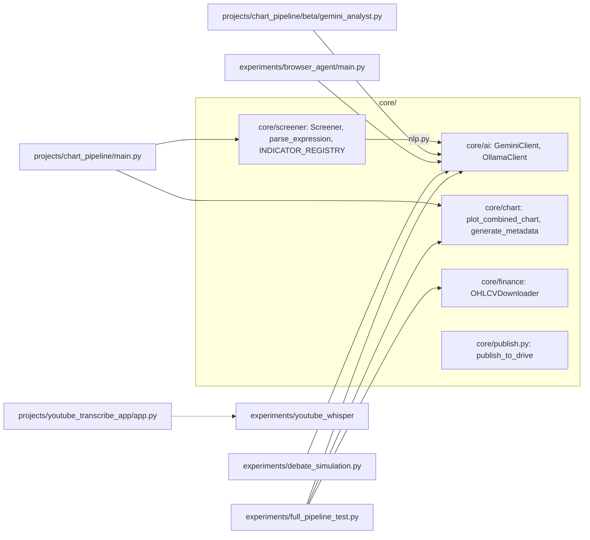
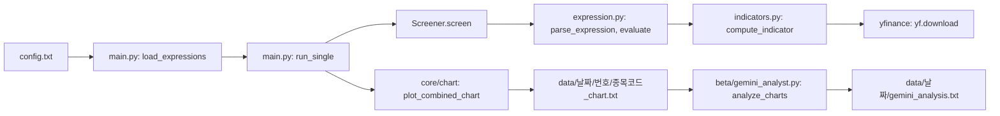
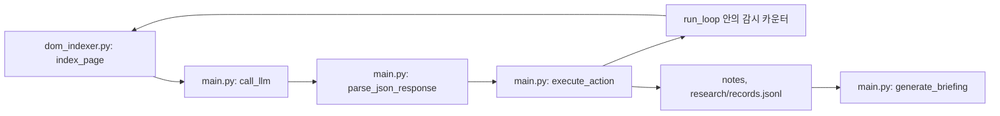
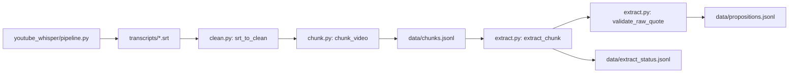

# HAN_LAB

One-line summary: A personal Python monorepo where reusable modules (a KOSPI 200 expression screener, an ASCII candlestick renderer, thin Gemini/Ollama clients) are extracted from throwaway experiments (a local-LLM browser agent, a YouTube-to-claims extraction pipeline) and from one daily chart-analysis project.

## 한 줄 소개

금융 데이터와 로컬 LLM을 다루는 실험을 빠르게 만들고, 두 곳 이상에서 쓰인 코드만 `core/`로 올리는 규칙으로 운영하는 개인 연구용 모노레포이다.

## 무엇을 왜 만들었나

이 저장소는 2026년 4월 17일에 시작해 5월 30일까지 19개 커밋으로 쌓였다. 주제는 세 가지이다. 첫째는 주가 데이터에 조건식을 걸어 종목을 거르고, 걸러진 종목의 차트를 LLM이 읽을 수 있는 텍스트로 바꾸는 일이다. 둘째는 작은 로컬 LLM에게 브라우저 조작을 맡기는 에이전트를 실험하는 일이다. 셋째는 유튜브 영상을 받아 음성을 글로 옮기고, 그 글에서 "누가 무엇을 주장했는가"를 구조화된 명제로 뽑는 일이다.

실험이 늘수록 같은 코드를 복사해 쓰게 되는 문제가 먼저 보였다. 그래서 폴더를 `core/`(재사용), `experiments/`(버려도 되는 실험), `projects/`(살아남은 결합물), `archive/`(죽은 실험)로 나누고, 복사하지 않고 import 한다는 규칙을 `AGENTS.md`와 `CLAUDE.md`에 적어 두었다. 코드의 대부분은 AI 코딩 도구가 작성했고, 작성자는 방향과 구조를 정하는 역할을 맡았다. 이 역할 분담도 두 문서에 그대로 적혀 있다. 이 README가 설명하는 것은 그 결과물이 실제로 어떻게 동작하고, 어디서 막혔으며, 무엇이 남았는가이다.

## 핵심 구조

의존 방향은 `experiments`와 `projects`에서 `core`로 향하는 한 방향이다. 예외가 하나 있고, 그 예외는 뒤의 "배운 점과 한계"에 적었다.



차트 분석 프로젝트의 데이터 흐름은 다음과 같다. `config.txt`의 한 줄이 조건 하나이고, 조건마다 결과 폴더가 따로 생긴다.



브라우저 에이전트는 한 단계마다 페이지를 인덱싱하고, LLM이 고른 행동을 실행하고, 반복 상태를 감시한다.



영상 글에서 명제를 뽑는 파이프라인은 단계마다 중간 파일을 남긴다.



## 주요 기능

### core

`core/screener`는 `rsi(_, 14) < 30 && volume_change_pct(_) > 50` 같은 문자열 조건식을 토크나이저, 재귀 하강 파서, 평가기로 처리한다. 인자 자리의 `_`는 "전체 종목"을 뜻하고, 마지막 인자가 파라미터 수보다 하나 많으면 그 값을 "N일 전" 이동량으로 해석한다. 조건식에서 쓸 수 있는 지표는 `INDICATOR_REGISTRY`에 등록된 26개이다(RSI, MACD, 볼린저, OBV, 스토캐스틱, ADX 등). `Screener.screen`은 `core/kospi200.xlsx`의 200개 종목에 조건식을 적용하고, `Screener.screen_natural`은 Gemini에게 자연어 조건을 수식으로 바꾸게 한 뒤 같은 경로로 실행한다(자연어 경로는 API 키가 필요해 검증 안 함).

`core/chart`는 OHLCV 데이터프레임을 캔들, 거래량, RSI, 롤링 OBV가 한 장에 들어가는 텍스트 차트로 바꾼다(`plot_combined_chart`). 같은 모듈의 `generate_metadata`는 이동평균 위치, 볼린저 밴드 수축과 확장, 거래량 추세, 모멘텀, RSI 상태를 문장으로 만들어 차트 옆에 붙일 수 있게 한다. `make_training_samples`는 패턴 구간 라벨을 받아 차트와 메타데이터와 라벨을 묶은 학습 샘플을 만든다.

`core/ai`는 Gemini와 Ollama를 같은 모양(`generate`, `chat`)으로 감싼 클라이언트이다. `core/finance`의 `OHLCVDownloader`는 스레드 풀로 종목을 내려받아 pickle로 캐시한다. `core/publish.py`는 산출물 파일을 외부 폴더로 한 방향 복사한다.

### projects

`projects/chart_pipeline`은 `config.txt`에 적힌 조건마다 코스피 200을 훑고, 걸러진 종목의 텍스트 차트를 `data/날짜/번호/`에 저장한다. 베타 단계의 `gemini_analyst.py`는 저장된 차트를 읽어 Gemini에게 추세, 지지와 저항, 거래량, 신호, 위험 요인을 묻고 결과를 파일로 남긴다. `reports/`에는 2026년 4월 23일부터 29일까지 6일치 분석 리포트가 있다.

`projects/youtube_transcribe_app`은 `experiments/youtube_whisper`의 다운로드와 전사 함수를 재사용하는 Flask 화면 하나짜리 앱이다. 모델은 첫 요청에서 한 번만 불러오고, 동시 요청은 한 개만 처리하도록 `threaded=False`로 두었다.

### experiments

`experiments/browser_agent`는 이미 떠 있는 Chrome에 CDP로 붙어 자연어 목표를 한 단계씩 수행하는 에이전트이다. 모드는 두 가지이다. `action`은 클릭, 입력, 스크롤, 뒤로 가기 같은 단순 자동화이고, `research`는 본문 추출, 끝까지 스크롤, 할 일 큐 추가를 더해 자료를 모은 뒤 브리핑 파일을 만든다. 같은 폴더의 `run_suite.py`는 `scenarios/`의 시나리오 묶음을 순서대로 실행하고 결과를 DONE, FAIL, TIMEOUT, CRASH, NO_STEPS, MAX_STEPS 중 하나로 분류해 표로 남긴다. `ingest/`에는 RSS, Reddit JSON, 유튜브 자막, 이미 본 URL을 거르는 캐시가 있다.

`experiments/youtube_whisper`는 yt-dlp로 영상이나 채널 최신 영상을 받아 faster-whisper로 `.txt`와 `.srt`를 만든다. `experiments/insight_pipeline`은 그 `.srt`를 읽어 전사 환각 후보를 표시하고, 약 60초 단위 청크로 자르고, 로컬 LLM이 청크마다 명제를 뽑게 한다. 뽑힌 명제에는 방향, 시간 범위, 확신 수준, 검증 가능 여부 같은 필드가 붙는다.

`experiments/capability_map.md`와 `quiz_solver.py`는 로컬 모델이 어떤 일을 맡길 만한지 20문제로 재 본 기록이다. 그 밖에 `debate_simulation.py`(여러 로컬 모델이 토론하는 시뮬레이션)와 `chart_demo.py` 같은 단발 스크립트가 있다.

## 실행 방법

설치는 저장소 루트에서 한 번이다. 이 명령은 `core*` 패키지만 설치하며, 실험이 쓰는 라이브러리는 포함하지 않는다(검증 안 함).

```bash
git clone https://github.com/Gachon-junghyun/HAN_LAB
cd HAN_LAB
pip install -e .   # (검증 안 함)
```

차트 분석 파이프라인은 `config.txt`의 조건을 고친 뒤 실행한다. 이 스크립트는 스스로 저장소 루트를 `sys.path`에 넣기 때문에 위 설치 없이도 import 가 된다. 종목마다 yfinance 로 시세를 내려받으므로 네트워크가 필요하고, 코스피 200 전체를 조건마다 훑어 시간이 오래 걸린다(검증 안 함).

```bash
python projects/chart_pipeline/main.py                      # (검증 안 함)
python projects/chart_pipeline/beta/gemini_analyst.py --help
python projects/chart_pipeline/beta/gemini_analyst.py --date 2026-04-23   # (검증 안 함, GEMINI_API_KEY 필요)
```

수식 파서와 차트 렌더러는 네트워크 없이 합성 데이터로 확인할 수 있다. 아래 코드는 저장소 루트에서 실행했을 때 동작한다.

```python
import numpy as np, pandas as pd
from core.screener import parse_expression, compute_indicator
from core.chart import plot_combined_chart, generate_metadata

ast = parse_expression("rsi(_, 14) < 30 && volume_change_pct(_) > 50")

n = 120
close = 100 + np.cumsum(np.sin(np.arange(n) / 5))
df = pd.DataFrame({
    "open": close - 0.3, "high": close + 1, "low": close - 1, "close": close,
    "volume": np.random.RandomState(0).randint(1000, 5000, n),
}, index=pd.date_range("2025-01-01", periods=n))

print(compute_indicator("rsi", df))
print(plot_combined_chart(df, cols=60))
print(generate_metadata(df))
```

영상 전사와 명제 추출은 GPU, ffmpeg 계열 도구, 로컬 Ollama 서버가 있어야 한다. 도움말만 확인했다.

```bash
python experiments/youtube_whisper/pipeline.py --help
python experiments/youtube_whisper/pipeline.py -r experiments/youtube_whisper/list.txt --language ko   # (검증 안 함)
python experiments/insight_pipeline/run.py chunks    # (검증 안 함)
python experiments/insight_pipeline/run.py extract   # (검증 안 함, 오래 걸림, 중단 후 재실행하면 이어서 처리)
python -m core.publish --help
```

브라우저 에이전트는 Chrome 을 `--remote-debugging-port=9222`로 먼저 띄워야 하며, 자세한 절차는 `experiments/browser_agent/README.md`에 있다. 이 스크립트는 import 시점에 `logs/`, `research/`, `briefings/` 폴더와 로그 파일을 만들기 때문에 도움말도 실행해 보지 않았다(검증 안 함).

## 폴더 구조

```text
HAN_LAB/
  core/                      재사용 모듈 (ai, chart, finance, screener, publish.py, kospi200.xlsx)
  projects/
    chart_pipeline/          main.py, config.txt, ticker.txt, beta/, reports/, data/
    youtube_transcribe_app/  app.py, templates/index.html
  experiments/
    browser_agent/           main.py, dom_indexer.py, run_suite.py, ingest/, scenarios/
    insight_pipeline/        clean.py, chunk.py, extract.py, schema.py, prompts.py, run.py, data/
    youtube_whisper/         pipeline.py, transcribe.py, yt_download.py, channel_fetch.py, transcripts/
    research_agent/          HANDOFF.md (설계 문서만 있음)
    capability_map.md, quiz_solver.py, quiz_data.json, debate_simulation.py, 기타 단발 스크립트
  study/                     pandas 연습 12개와 xgboost 직접 구현 연습 등
  archive/                   로컬 LLM 실행 중 GPU, CPU 온도와 사용량을 재는 스크립트 4개, 차트 분석 프롬프트 파일(ex_prompt)
  AGENTS.md, CLAUDE.md, codingforme.md   AI 코딩 도구에게 주는 작업 규칙
```

파일이 700개를 넘지만 코드는 일부이다. `experiments`와 `projects`의 파일 수 대부분은 전사문, 차트 텍스트, 실행 기록 같은 데이터이다.

## 배운 점과 한계

### 1. 스크리너의 데이터 신선도와 실행 시간

처음에는 `OHLCVDownloader`가 만든 pickle 캐시를 우선 읽고, 없을 때만 yfinance 로 내려받게 만들었다(커밋 e0b7507). 같은 날 몇 시간 뒤 캐시 경로를 전부 지우고 항상 yfinance 최신 데이터를 쓰도록 바꿨다(커밋 a2260cf). 커밋 메시지는 이유를 적지 않았다. 오래된 캐시로 오늘 조건을 판정하면 결과가 의미 없어지기 때문으로 읽히지만, 이는 추정이다.

그 대가는 속도였다. 4월 23일부터 29일까지의 리포트 6개 중 5개가 fallback 실행을 적고 있고, 그중 4개는 이유로 "main.py 스크리너 타임아웃"을 적었다. fallback 은 4월 23일 스크리너가 고른 종목 중 58개를 모은 `ticker.txt`를 직접 분석하는 방식이었다. 느린 원인은 코드에서 확인된다. `Screener.screen`은 200개 종목을 순서대로 하나씩 내려받고, 종목 하나가 끝날 때마다 메모리 캐시를 비우며, 조건이 둘이면 같은 200개를 두 번 내려받는다. 스레드 풀을 쓰는 다운로더가 `core/finance`에 이미 있는데 스크리너는 그것을 쓰지 않는다. 전체를 한 번 병렬로 받아 조건들이 공유하는 방식이 다음 개선 대상이다. 또한 fallback 을 실행한 스크립트는 저장소에 없고 결과물(`data/`의 fallback 폴더와 `analysis_raw.json`)만 남아 있어, 재현 가능한 코드로 승격하지 못한 상태이다.

### 2. 작은 로컬 모델에게 맡길 일과 맡기지 않을 일

브라우저 에이전트를 설계하기 전에 로컬 모델(gemma4:e4b)의 능력을 먼저 쟀다. `quiz_data.json`의 20문제를 문제마다 독립된 대화로 풀게 했고, 기록된 결과는 13개 정답, 4개 조건부, 3개 오답이다. 계산, 코드 리뷰, 표준 개념 설명은 맡겨도 괜찮았고, 긴 사실 목록 회상에서는 환각이 났다(조선 왕 27명을 나열하게 한 문제에서 순서가 틀리고 "분량상 생략"으로 끝났다. `quiz_solve.md`에서 확인했다). 이 결과가 `experiments/research_agent/HANDOFF.md`의 설계 제약으로 이어졌다. LLM은 "다음에 어디로 갈지"만 정하고, 페이지 본문과 사실은 LLM을 거치지 않고 결정론 코드가 추출해 저장한다는 원칙이다.

같은 원칙이 명제 추출에도 들어갔다. 모델이 돌려준 `raw_quote`가 청크 원문에 부분 문자열로 존재하는지 `validate_raw_quote`가 검사하고, 통과하지 못한 명제는 버리면서 버린 개수를 따로 센다. 한계도 있다. 표본은 20문제로 작고, 모델 하나만 쟀다. 문서가 말하는 "위임 가능" 범위는 가이드이지 보증이 아니다.

### 3. 에이전트 루프가 멈추지 않는 문제

초기 버전(커밋 c3c1b2d, main.py 650줄)은 모델이 `done`을 내거나 최대 단계에 닿을 때까지 도는 단순한 루프였다. 이후 현재의 1030줄이 되기까지 코드 주석에 남은 문제와 대응은 다음과 같다.

| 문제 | 바꾼 방식 |
|---|---|
| 작은 모델의 응답이 JSON 이 아니어서 파싱 실패 | Ollama 호출에 `format="json"`을 강제하는 하위 클래스(`OllamaJsonClient`)와, 코드블록과 앞뒤 잡설을 걷어내는 `parse_json_response`, 실패 시 재시도 |
| 재시도 안내문을 사용자 메시지로 오해해 작업을 포기하는 모델 | 안내문 머리에 "자동 재요청 신호"임을 밝히고, 종료 메시지에 그 안내문이 섞여 나오는지 정규식으로 검사 |
| 존재하지 않는 행동 이름을 반복 출력 | 연속 3회, 누적 5회에서 강제 종료 |
| 같은 행동을 끝없이 반복(무한 스크롤 등) | 같은 (행동, 번호, 텍스트)가 정상 결과로 6회 반복되면 강제 종료 |
| 로그인 벽에서 같은 화면을 반복 | 처음에는 인덱스 목록의 해시로 무변화를 판정했으나 SPA의 미세한 변화에 뚫려, 페이지 본문 앞 3000자의 해시로 바꿈 |
| 시작 사이트를 벗어나 헤맴 | 외부에서 4단계를 넘기면 시작 URL 로 자동 복귀 |
| 검색 결과 페이지가 1.5초 안에 다 뜨지 않아 본문이 비어 있음 | 대기를 5초로 늘림 |
| SPA 인덱스가 한 줄 600KB 이상이라 grep 과 로그 읽기가 불가능 | 인덱스를 줄 단위로 나누어 기록 |

이 과정에서 얻은 습관은 실행 기록을 세 겹으로 남기는 것이다. 사람이 읽는 `.log`, 단계별 URL과 행동과 결과만 담은 `.summary.tsv`, 단계마다 LLM 입출력 전체를 담은 `.steps.jsonl`이다. `run_suite.py`는 `main.py`의 요약 컬럼 상수를 import 해 헤더가 어긋나면 즉시 실패시키므로, 기록 형식이 바뀌었는데 조용히 결과가 깨지는 일은 막혀 있다. 반면 시나리오별 성공률 같은 수치는 저장소에 없다. 실행 산출물은 `.gitignore`로 제외되어 있어, "얼마나 잘 되는가"는 이 저장소만으로 말할 수 없다. iframe, Shadow DOM, 여러 탭 조율은 지원하지 않으며(`browser_agent/README.md`에 한계로 적혀 있다), 로그인이 필요한 사이트는 비로그인 상태로 읽을 수 있는 범위까지만 다룬다. `ingest/`에는 화면을 읽는 대신 RSS, Reddit JSON, 유튜브 자막처럼 구조화된 경로로 가져오는 모듈도 따로 두었다(Reddit 모듈 주석은 HTML 크롤링보다 깔끔하다고 적었다).

### 4. 오래 걸리는 추출 작업과 모델 선택

명제 추출은 한 청크에 수십 초에서 수백 초가 걸려서, 도중에 끊겨도 이어갈 수 있게 만들어야 했다. `run.py`는 청크 하나가 끝날 때마다 처리 결과를 `extract_status.jsonl`에 덧붙여 쓰고, 다시 실행하면 이미 끝난 `chunk_id`를 건너뛴다. 실행 중에는 Windows 절전을 막는다. 전사 환각은 같은 문장이 5개 구간 안에 4번 이상 반복되면 의심으로 표시하되 발화는 지우지 않는다(`clean.mark_hallucinations`). 지우는 것보다 놓치는 쪽이 더 나쁘다는 판단이 모듈 주석에 적혀 있다.

상태 파일을 모델별 백업과 비교하면 모델 선택의 흔적이 보인다. 아래 수치는 각 파일의 기록을 직접 합산한 값이며, 파일에는 모델 이름이 기록되지 않아 이름은 백업 파일 이름을 따랐다.

| 파일 | 처리 청크 | 명제 | 버려진 항목 | 청크당 평균 시간 |
|---|---|---|---|---|
| extract_status.gemma4.backup.jsonl | 3 | 31 | 0 | 약 172초 |
| extract_status.qwen.backup.jsonl | 63 | 166 | 33 (약 17%) | 약 31초 |
| extract_status.jsonl (현재) | 202 | 1060 | 20 (약 2%) | 약 115초 |

청크당 시간이 가장 짧은 파일에서 버려진 항목의 비율이 가장 높았다. 버려지는 기준은 인용문이 원문에 없거나 형식이 맞지 않는 경우이다. 현재 코드의 기본 모델은 `gemma2:9b`이다. 모듈 상단 설명은 아직 `gemma4:e4b`라고 적혀 있어 코드와 문서가 어긋난다. 남은 한계는 분명하다. 청크 1601개 중 202개(약 13%)만 처리했고, 같은 속도라면 나머지에 약 45시간이 든다(위 평균에서 계산한 추정). 뽑힌 명제의 정확도는 사람이 채점한 정답 데이터가 없어 측정하지 못했고, 지금 확인된 것은 "인용문이 원문에 실제로 있다"는 것뿐이다.

### 5. 모노레포 규칙이 지켜진 곳과 어긋난 곳

복사하지 않고 import 한다는 규칙은 대체로 지켜졌다. 스크리너의 자연어 변환, 브라우저 에이전트, 토론 시뮬레이션, 차트 분석기가 모두 `core/ai`의 클라이언트를 import 해서 쓴다. 승격 후보는 `@core-candidate` 주석으로 표시했고, 두 곳 이상에서 쓰일 때 `core/`로 올린다는 기준을 문서에 적었다.

어긋난 곳도 있다. `projects/youtube_transcribe_app`은 `experiments`의 모듈을 `sys.path`를 조작해 가져온다. 코드 주석이 이를 인정하고 "검증이 끝나면 `core/`로 승격해 이 방식을 없앤다"고 적었지만 아직 승격하지 않았다. `pyproject.toml`은 `core*`만 패키지로 잡고 있어, `ollama`, `playwright`, `faster-whisper`, `flask`, `yt-dlp`처럼 실험이 쓰는 라이브러리는 설치 대상에 없다. 새로 받은 환경에서는 실험마다 직접 설치해야 하고, 그 목록을 한곳에 모은 파일이 없다.

문서가 코드를 따라가지 못한 곳도 확인했다. `gemini_analyst.py`는 `data/날짜/` 바로 아래의 `*_chart.txt`만 찾는데(재귀 검색이 아니다), 조건별 폴더를 만들도록 바꾼 커밋(cb54638) 이후 `main.py`는 차트를 `data/날짜/번호/`에 저장한다. 코드를 읽어서 확인한 불일치이며, 이 때문에 베타 분석기는 여러 조건 구조의 결과를 찾지 못할 것으로 보인다(실행 확인은 하지 않았다). `config.txt`의 안내는 `ma(_, 20)`을 쓸 수 있다고 하지만 등록된 이동평균 지표는 `sma`뿐이며, `eval_expression_safe`로 확인하면 `Unknown indicator: ma` 오류가 난다. `screener.py` 상단 주석은 아직 "pkl 캐시 우선"이라고 적고 있고, 캐시를 제거한 뒤에도 `expression.py`에 `set_cache_dir`이 남아 있다. 기존 README의 사용 예 `core.chart.text_chart`는 없는 경로이고(실제 위치는 `core.chart`의 `plot_text_chart`), `CLAUDE.md`가 소개한 `core/ChartLlm_Core`는 저장소에 없다.

### 6. 아직 하지 않은 것

자동화 테스트와 CI 는 없다. `AGENTS.md`가 요청 없이는 추가하지 말라고 적어 두었고, 지금까지 검증은 스크립트를 직접 돌려 보는 방식이었다. 스크리너에는 백테스트용 훅(`peak_drawdown`, `set_trade_context`)만 있고 백테스트 엔진은 없어서, 리포트의 점수가 이후 수익과 관련이 있는지는 검증하지 않았다. 이 저장소의 분석 리포트는 지표 점수를 정리한 기록이며 투자 판단의 근거로 쓰도록 만든 것이 아니다.
